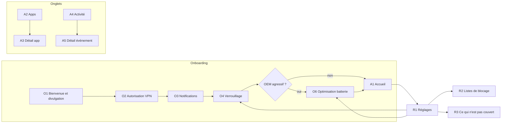

# aKeeper — Écrans UI

Complète `etude_technique_cybersecurite_android_mobileshield_2026-v2.md` (§8 résilience, §9 Play, §10 limites) et `docs/preconisation-initialisation.md` (Java + Views Material 3).

## 1. Principes

| Principe | Application |
|---|---|
| Protégé par défaut | Après l'onboarding, la protection est active avec les listes par défaut, sans configuration préalable |
| Un état, une action | Chaque état de l'accueil propose **une seule** action principale |
| Statut lisible sans la couleur | Icône + titre + couleur (vert / ambre / rouge), libellés compatibles TalkBack |
| Annuler plutôt que confirmer | Bloquer ou autoriser une app agit immédiatement, avec un snackbar « Annuler ». Une confirmation n'est demandée que pour ce qui réduit la protection globale |
| Pas de jargon | « Verrouillage » plutôt que *lockdown*, « contournement DNS » plutôt que DoH/DoT, « DNS privé » (terme d'Android) |
| 3 gestes maximum | Bloquer une app : onglet Apps → interrupteur. Débloquer un domaine depuis l'activité : ligne → « Autoriser » |
| Pause sans fuite ni coupure | « Pause » ne coupe **jamais** le VPN : avec le verrouillage, cela couperait tout Internet. Le moteur passe en politique « tout autoriser » pour une durée limitée |

## 2. Navigation



Une seule Activity, des Fragments, la barre de navigation inférieure (Accueil · Apps · Activité) et l'icône Réglages dans la barre supérieure. Les écrans O4 et O6 restent accessibles depuis les réglages pour revenir dessus plus tard.

## 3. Onboarding

Il n'est affiché qu'une fois. Si l'app est quittée en cours de route, il reprend à l'étape non validée. Sur un appareil géré par MDM (always-on imposé par `setAlwaysOnVpnPackage`), O2 et O4 sont validés automatiquement.

### O1 — Bienvenue et divulgation

Cet écran est exigé par la politique Play VpnService **avant** l'appel à `VpnService.prepare()`.

- Titre : « aKeeper filtre le trafic de vos apps, directement sur votre téléphone ».
- Trois points :
  - « Bloque publicités, traqueurs et sites malveillants. »
  - « Vous choisissez quelles apps accèdent à Internet. »
  - « Tout est traité localement : aucun trafic n'est envoyé à nos serveurs. »
- Lien « Données traitées » : liste exhaustive (domaines consultés, gardés au plus 7 jours sur l'appareil ; aucun contenu).
- Action : **Continuer**.

### O2 — Autorisation VPN

- Explique la boîte de dialogue système à venir : « Android va vous demander d'autoriser une connexion VPN. aKeeper l'utilise pour filtrer le trafic localement, pas pour le faire passer par un serveur. »
- Action : **Autoriser**, qui appelle `prepare()` puis ouvre la boîte de dialogue système.
- En cas de refus, l'écran reste affiché avec le message « Sans cette autorisation, aKeeper ne peut pas fonctionner » et le bouton **Réessayer**.

### O3 — Notifications

- « Recevoir une alerte si la protection s'arrête. »
- Action : **Activer**, qui déclenche `POST_NOTIFICATIONS`. Le lien « Plus tard » est autorisé : l'accueil affichera alors une carte de rappel.

### O4 — Verrouillage (bloquant)

```
┌──────────────────────────────────┐
│  Dernière étape : le verrouillage│
│                                  │
│  Si aKeeper s'arrête, Android    │
│  bloque Internet au lieu de      │
│  laisser passer le trafic.       │
│                                  │
│  1. Touchez ⚙ à côté d'aKeeper   │
│  2. Activez « VPN permanent »    │
│  3. Activez « Bloquer les        │
│     connexions sans VPN »        │
│                                  │
│  [ Ouvrir les réglages VPN ]     │
│                                  │
│  ○ VPN permanent                 │
│  ○ Connexions sans VPN bloquées  │
└──────────────────────────────────┘
```

- Le bouton ouvre `Settings.ACTION_VPN_SETTINGS`.
- Au retour dans l'app (`onResume`), les deux pastilles sont mises à jour depuis `isAlwaysOn()` et `isLockdownEnabled()`. L'étape est validée automatiquement quand les deux sont vraies, sans bouton « J'ai fini ».
- Les libellés des réglages varient selon l'OEM : afficher le texte AOSP, avec une capture par OEM détecté si elle existe.

### O6 — Optimisation batterie (conditionnel)

Cet écran n'est affiché que si `Build.MANUFACTURER` fait partie des OEM du guide (§8.5 de la spec : Xiaomi, Samsung, Oppo/OnePlus, Vivo, Honor).

- Étapes propres à l'OEM : démarrage automatique, exclusion des « apps en veille prolongée ».
- Actions : **Ouvrir les réglages** (intent OEM s'il existe, sinon fiche de l'app) et **Terminer**.

## 4. Écrans principaux

### A1 — Accueil

```
┌──────────────────────────────────┐
│ aKeeper                       ⚙  │
│                                  │
│        ( ✓ )                     │
│      Protégé                     │
│  Verrouillage actif              │
│                                  │
│  ┌ Aujourd'hui ────────────────┐ │
│  │ 1 284 requêtes bloquées     │ │
│  │ 3 apps sans accès Internet  │ │
│  │ Top : ads.example, …        │ │
│  └─────────────────────────────┘ │
│                                  │
│  [ Pause 15 min ]                │
├──────────────────────────────────┤
│  Accueil  ·   Apps   ·  Activité │
└──────────────────────────────────┘
```

| État (priorité décroissante) | Condition | Titre | Action unique |
|---|---|---|---|
| Rouge — Non protégé | VPN révoqué (`LockdownStatus.REVOKED`, un autre VPN est actif) | « Protection désactivée par une autre app VPN » | **Réactiver** (`prepare()`) |
| Rouge — Non protégé | Service arrêté, sans révocation | « Protection arrêtée » | **Redémarrer** |
| Ambre — Partiel | `isLockdownEnabled() == false` | « Protégé, mais sans verrouillage » | **Activer le verrouillage**, vers O4 |
| Ambre — Partiel | DNS privé strict détecté (§6 : TCP/853 vers une IP tierce) | « Le DNS privé empêche le filtrage des sites » | **Ouvrir les réglages réseau** |
| Ambre — En pause | Pause active | « En pause — reprise à 14:32 » | **Reprendre maintenant** |
| Vert — Protégé | Tout est nominal | « Protégé » | **Pause 15 min** |

- Les cartes secondaires apparaissent sous le résumé et peuvent être fermées, sauf les alertes rouges :
  - notifications refusées ;
  - profil professionnel ou Private Space détecté (« non couvert », lien vers R3), affiché une seule fois ;
  - moteur redémarré après un arrêt inattendu ;
  - règles non mises à jour depuis plus de 14 jours.
- Les compteurs proviennent des événements agrégés : aucune requête lourde sur le thread UI.

### A2 — Apps

```
┌──────────────────────────────────┐
│ 🔍 Rechercher une app            │
│ [Toutes] [Bloquées] [Récentes] [Système] │
│                                  │
│ ▣ Navigateur        1,2 Mo   ●━  │
│ ▣ Réseau social     8,4 Mo   ━○  │  ← bloquée
│ ▣ Météo             12 Ko    ●━  │
│ …                                │
└──────────────────────────────────┘
```

- Une ligne par app : icône, nom, volume des dernières 24 h, interrupteur **Accès Internet**.
- Le filtre par défaut est « Récentes » (apps ayant émis du trafic dans les 24 h) : la liste utile tient sur un écran.
- Basculer l'interrupteur applique la règle immédiatement, avec le snackbar « Réseau social bloqué · Annuler ».
- Les apps système sont masquées par défaut (filtre « Système »). Bloquer une app système critique affiche une confirmation (« Certaines fonctions du téléphone peuvent cesser de marcher »).
- Une app à UID partagé affiche le badge « partagé ».

### A3 — Détail app

- En-tête : icône, nom, interrupteur **Accès Internet**.
- Si l'UID est partagé : « Cette app partage son accès réseau avec : X, Y. La règle s'applique à toutes. »
- Section **Activité récente** : domaines contactés, avec un compteur et le verdict par domaine. Toucher un domaine ouvre A5.
- Section **Données** : volume sur 24 h et 7 jours.
- Hors MVP : règles distinctes Wi-Fi / données mobiles.

### A4 — Activité

- Journal chronologique groupé par heure : `domaine · app · Bloqué | Autorisé · 14:05`.
- Filtres : **Bloqués** (par défaut) · Autorisés · par app (sélecteur).
- Une recherche par domaine.
- Pied de liste : « Historique conservé 7 jours sur cet appareil ».
- Si le journal est désactivé (R1), l'état vide affiche « Journal désactivé » avec le bouton **Activer**.

### A5 — Détail événement (bottom sheet)

- Domaine, app, heure, raison du verdict : « Liste Traqueurs », « Contournement DNS bloqué », « App sans accès Internet » ou « Règle personnelle ».
- Actions selon le verdict :
  - pour un événement bloqué : **Autoriser ce domaine** (ajout aux exceptions personnelles) ;
  - pour un événement autorisé : **Bloquer ce domaine** ;
  - **Copier le domaine**, dans tous les cas.
- Un domaine bloqué par la catégorie « Contournement » ne peut pas être autorisé ici (voir R2).

## 5. Réglages

### R1 — Réglages

| Section | Éléments |
|---|---|
| Protection | Listes de blocage → R2 · Mise à jour des règles (version, date, bouton **Mettre à jour**) |
| Fiabilité | État du verrouillage → O4 · Optimisation batterie → O6 (si OEM concerné) |
| Réseau | **Ne pas filtrer le réseau local** (désactivé par défaut ; avertissement « Les apps pourront envoyer des données aux appareils de votre réseau sans filtrage ») |
| Vie privée | Journal d'activité (activé/désactivé) · Durée de conservation (1, 3 ou 7 jours ; 7 au maximum) · **Effacer le journal** (confirmation) · Statistiques anonymes (désactivées par défaut) |
| À propos | Ce qui n'est pas couvert → R3 · Licences (GPL-3.0) · Version |

Quand la **Protection avancée Android** est active, une bannière s'affiche en tête des réglages : « Protection avancée d'Android active : certains réglages sont verrouillés ». L'option réseau local est alors désactivée et grisée, avec cette explication (`ShieldPolicy.hardened()`).

### R2 — Listes de blocage

- Catégories avec interrupteur : Publicités et traqueurs (niveau « standard » / « renforcé ») · Hameçonnage · Sites malveillants (dès qu'une source est autorisée). Par défaut, « Publicités et traqueurs » en niveau standard (HaGeZi LIGHT) et « Hameçonnage » (Phishing Army) sont activés. Sources et licences : `docs/listes-de-blocage.md`.
- **Contournement DNS** : toujours actif, sans interrupteur, avec la mention « Empêche les apps d'échapper au filtrage ». Le désactiver viderait toutes les autres règles de leur sens.
- **Exceptions personnelles** : domaines toujours autorisés, ajout manuel ou depuis A5.
- **Domaines bloqués personnels** : ajout manuel ou depuis A5.
- La saisie d'un domaine est validée en direct (format, pas de joker hors préfixe `*.`).

### R3 — Ce qui n'est pas couvert

Il reprend le §10 de la spec, en langage simple :
- profil professionnel, Private Space et partage de connexion ;
- certaines apps système qui partagent leur accès réseau ;
- DNS privé en mode strict : filtrage des sites impossible ;
- sans verrouillage : la protection n'est pas garantie si l'app s'arrête ;
- le contenu des pages chiffrées n'est jamais lu.

## 6. Hors application

| Élément | Contenu |
|---|---|
| Notification permanente (canal « Statut », importance basse, exigée par le service de premier plan) | « Protégé · 1 284 bloquées aujourd'hui ». Actions : **Pause 15 min** · **Ouvrir** |
| Notification d'alerte (canal « Alertes », importance haute) | Protection arrêtée ou révoquée · verrouillage désactivé · DNS privé strict détecté. Toucher la notification ouvre A1 sur l'état correspondant |
| Tuile Réglages rapides (`TileService`) | État Protégé / En pause / Arrêté ; un appui bascule la pause ; un appui long ouvre A1 |

Pas de widget au MVP.

## 7. Sources de données par écran

| Écran | Données | Source |
|---|---|---|
| A1 | État | `LockdownStatus` (`isAlwaysOn`, `isLockdownEnabled`, révocation), état du service, événements moteur (DNS strict, redémarrage) |
| A1, A2, A3, A4 | Compteurs, volumes, journal | Room (événements écrits par lots), requêtes paginées et indexées sur `ts` |
| A2, A3 | Liste des apps, UID partagés | `PackageManager` (`getInstalledApplications`, `getPackagesForUid`) |
| A2 → moteur | Règle par app | Table UID → verdict, remplacée atomiquement dans le moteur (`preconisation-initialisation.md` §4) |
| R1 | Protection avancée | `AdvancedProtectionPolicy` |
| R1 | Version des règles | Version monotone persistée (`rules`) |
| R2 | Exceptions et règles personnelles | Room, puis rechargement du moteur |

## 8. Points à valider

- **Visibilité des paquets** : lister toutes les apps exige `QUERY_ALL_PACKAGES`, permission restreinte par Google Play et soumise à déclaration. Sans elle, seules les apps déclarées via `<queries>` (intent `MAIN`/`LAUNCHER`) sont visibles. Ce point est à traiter avec le dossier Play VpnService (risque R-02).
- **DNS privé** : il n'existe pas d'intent public stable vers ce réglage. Repli prévu : `Settings.ACTION_WIRELESS_SETTINGS`, accompagné d'un texte d'aide.
- **Libellés OEM** du verrouillage et de l'optimisation batterie : captures à produire par OEM du guide.
